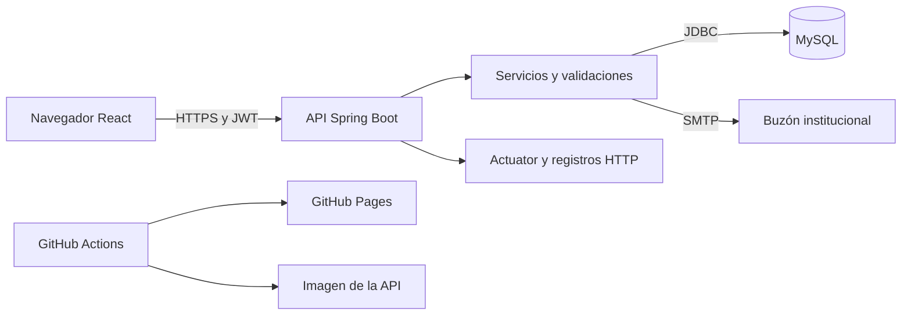

# Especificación de Órbita Campus

La universidad necesita un registro central para evitar pedidos perdidos, responsables indefinidos y falta de información sobre plazos. El piloto cubre mantenimiento, soporte informático, trámites administrativos y reserva de ambientes en Ciudad Universitaria. Una reserva se registra como solicitud de atención y queda sujeta a evaluación del área responsable.

| Actor | Visibilidad | Acciones |
| --- | --- | --- |
| Estudiante | Solicitudes propias | Registrar, consultar, comentar y retirar antes de la evaluación |
| Técnico | Solicitudes asignadas | Iniciar atención, comentar y resolver |
| Supervisor | Todas las solicitudes | Evaluar, ajustar prioridad, asignar, reasignar y cerrar |
| Administrador | Todas las solicitudes y catálogos | Supervisar, administrar usuarios, roles, áreas, categorías, plazos y etiquetas |

## Épicas e historias

| Épica | Historia | Criterio de aceptación |
| --- | --- | --- |
| Identidad | Como estudiante quiero usar mi correo UNMSM para acreditar mi cuenta. | Formato institucional válido, enlace de un solo uso y contraseña del registro, acceso después de verificar. |
| Identidad | Como usuario quiero recuperar o cambiar mi contraseña. | Enlace temporal enviado al correo verificado para recuperación, contraseña actual para cambio desde el perfil y revocación de sesiones anteriores. |
| Registro | Como estudiante quiero informar un problema con ubicación y evidencia. | Asunto, categoría, ubicación y descripción válidos producen un código y un plazo. |
| Atención | Como supervisor quiero asignar un técnico y priorizar el pedido. | Solo un técnico activo y verificado puede recibir una solicitud evaluada. |
| Atención | Como técnico quiero registrar avances y resolver mis asignaciones. | Las transiciones válidas y los comentarios se añaden al historial. |
| Seguimiento | Como solicitante quiero comprobar el progreso de mis pedidos. | Veo estado, plazo, responsable e historial de solicitudes propias. |
| Indicadores | Como supervisor quiero identificar solicitudes vencidas y tiempos de atención. | El tablero muestra conteos, distribución, tasa de resolución y tiempo promedio. |
| Administración | Como administrador quiero gestionar quién puede atender y qué servicios se ofrecen. | Cambiar un rol invalida sesiones anteriores. Los catálogos controlan los formularios. |

## Escenarios BDD

```gherkin
Característica: Gestión de solicitudes

  Escenario: El estudiante verifica el correo
    Dado un correo válido del dominio unmsm.edu.pe
    Cuando la persona se registra y confirma el enlace recibido con su contraseña de registro
    Entonces el enlace se consume una vez y la cuenta puede iniciar sesión

  Escenario: Registro con datos incompletos
    Dado un estudiante autenticado
    Cuando intenta crear una solicitud sin ubicación
    Entonces la API devuelve 400 y no crea el registro

  Escenario: Lectura de una solicitud ajena
    Dado un estudiante que conoce el identificador de otro pedido
    Cuando consulta el detalle de ese pedido
    Entonces la API devuelve 404 sin revelar sus datos

  Escenario: Asignación y atención
    Dado un pedido en evaluación y un técnico habilitado
    Cuando el supervisor lo asigna y el técnico inicia la atención
    Entonces el estado cambia a En atención y el historial conserva ambos cambios

  Escenario: Edición con una versión anterior
    Dado que dos personas consultaron la misma solicitud
    Cuando la segunda intenta guardar con una versión anterior
    Entonces la API devuelve 409 y conserva la primera actualización
```

## Arquitectura y prototipo



**Inicio** muestra el resumen, distribución, actividad reciente y guía. **Solicitudes** contiene filtros, alta y consulta de cada ficha. **Seguimiento** organiza por las seis etapas. **Indicadores** agrupa por categoría, prioridad y responsable. La portada permite acceder, registrarse, verificar el correo o recuperar la contraseña. **Mi cuenta** muestra el perfil y permite cambiar la contraseña o cerrar sesión. El panel de administración se habilita para el rol correspondiente.
