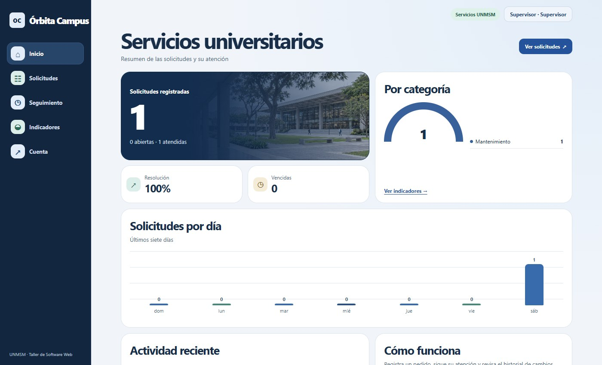

# Manual de usuario · Órbita Campus

## Entrar con tu cuenta UNMSM

Abre el [portal de Órbita Campus](https://andrey3210.github.io/orbita-campus/). Selecciona **Crear cuenta**, escribe tu nombre y un correo institucional con dominio exacto `unmsm.edu.pe` y elige una contraseña según las condiciones del formulario. Abre el enlace de verificación del mensaje institucional y confirma con la contraseña que acabas de elegir. El enlace vence en 30 minutos. Puedes solicitar otro desde **Reenviar verificación**.

Si olvidaste la contraseña, usa **¿Olvidaste tu contraseña?** y sigue el enlace que llegue a tu buzón. En **Cuenta** puedes cambiar la contraseña y cerrar sesión. Un cambio de contraseña o cierre revoca las sesiones anteriores.

## Estudiante

1. Entra en **Solicitudes** y selecciona **Nueva solicitud**.
2. Completa asunto, categoría, ubicación y descripción. Puedes incluir una evidencia mediante un enlace HTTPS con los permisos apropiados.
3. Pulsa **Registrar solicitud** y anota el código de la ficha. Usa el buscador por asunto, código o ubicación y los filtros por estado y categoría.
4. Abre la ficha para revisar el responsable, el plazo y los comentarios. Puedes retirar un pedido propio mientras siga registrado. Para comentar, abre **Historial y comentarios** y pulsa **Añadir comentario** mientras el caso siga abierto.

## Supervisor y técnico

- **Supervisor.** Abre un pedido registrado y guárdalo como **En evaluación**. Después selecciona **Asignada** y un técnico activo. Revisa la prioridad y el plazo. Cuando el técnico lo deje como **Resuelta**, valida el resultado y guárdalo como **Cerrada**.
- **Técnico.** La lista muestra los pedidos asignados a tu cuenta. Abre el pedido, guárdalo como **En atención**, registra el trabajo en un comentario y guarda **Resuelta**.
- **Seguimiento e indicadores.** Permiten revisar estados y plazos. Los datos se limitan al ámbito de cada cuenta.

## Administrador

Abre **Administración** para gestionar usuarios, roles, áreas, categorías, prioridades y etiquetas de estados. Las reasignaciones de rol y desactivaciones revocan el acceso anterior. La administración de catálogos se comprueba con una cuenta administradora.

## Incidencias

Si el formulario indica que el registro cambió, recarga el pedido y comprueba el estado vigente antes de guardar. Si la aplicación muestra una referencia de soporte, comparte esa referencia con el responsable del proyecto. Conserva tu contraseña y el enlace de verificación en privado.

